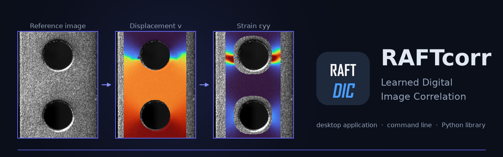
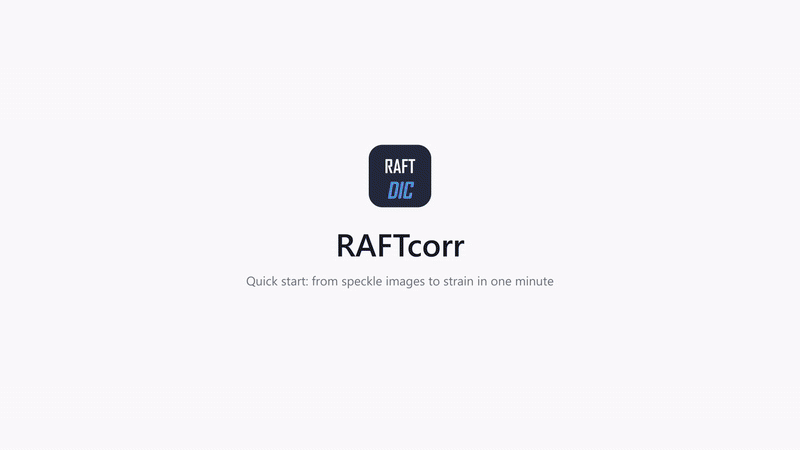
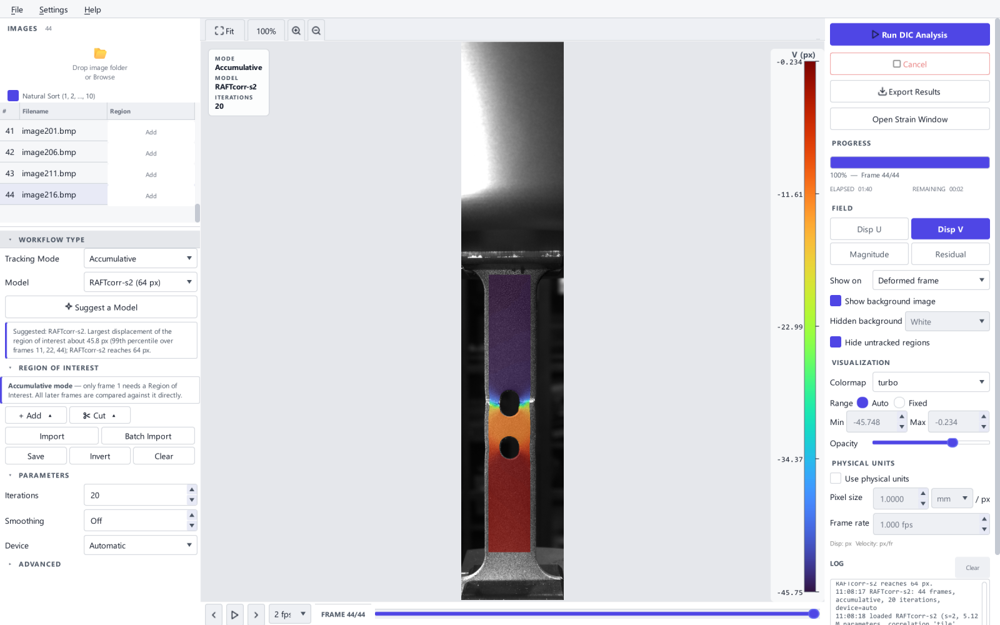
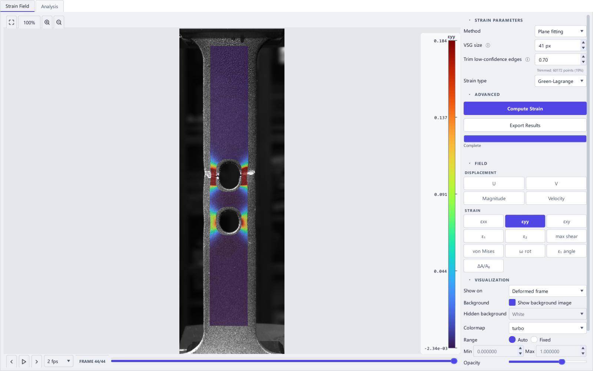
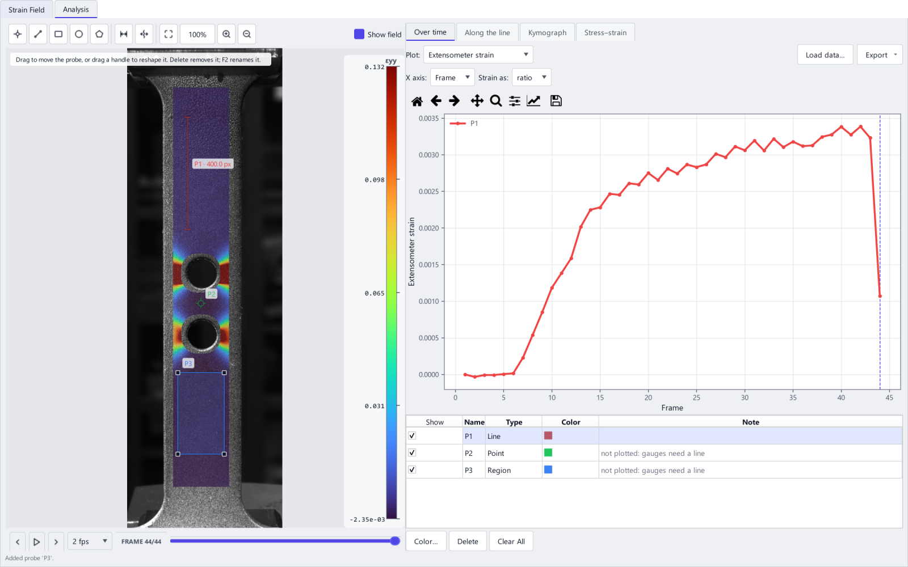

<p align="center">
  
</p>

<p align="center">
  Full-field displacement and strain from image sequences with learned correlation models:<br/>
  a desktop application, a command line and a Python library.
</p>

<p align="center">
  <a href="https://github.com/zachtong/RAFTcorr/actions/workflows/ci.yml"></a>
  <a href="https://pypi.org/project/raftcorr/"></a>
  
  
  
  <a href="https://github.com/zachtong/RAFTcorr/blob/main/LICENSE.md"></a>
</p>

<p align="center">
  
  
  
  
  
  
  
  
</p>

<p align="center">
  <a href="https://github.com/zachtong/RAFTcorr/releases/latest/download/RAFTcorr-Windows-Setup.exe"></a>
  &nbsp;
  <a href="https://github.com/zachtong/RAFTcorr/releases/latest/download/RAFTcorr-macOS.dmg"></a>
  <br/>
  <sub>No Python needed · <a href="#install">installation notes</a> · or <code>pip install raftcorr</code></sub>
</p>

<p align="center">
  <a href="https://github.com/zachtong/RAFTcorr/blob/main/docs/RAFTcorr_User_Guide.pdf"><b>User Guide (PDF)</b></a> ·
  <a href="https://github.com/zachtong/RAFTcorr/blob/main/docs/RAFTcorr_Quick_Guide.pdf"><b>Quick Guide (2 pages)</b></a> ·
  <a href="https://github.com/zachtong/RAFTcorr/blob/main/docs/media/RAFTcorr_quickstart_en.mp4"><b>Quick-start video</b></a> (<a href="https://github.com/zachtong/RAFTcorr/blob/main/docs/media/RAFTcorr_quickstart_zh.mp4">中文</a>)
</p>

---

<p align="center">
  
</p>
<p align="center">
  <i>From speckle images to strain in one minute. Full-HD video: <a href="https://github.com/zachtong/RAFTcorr/blob/main/docs/media/RAFTcorr_quickstart_en.mp4">English</a> · <a href="https://github.com/zachtong/RAFTcorr/blob/main/docs/media/RAFTcorr_quickstart_zh.mp4">中文</a>.</i>
</p>

## What RAFTcorr does

RAFTcorr measures full-field displacement and strain from image sequences with the RAFTcorr
networks: learned correlation models trained on speckle images with exact Lagrangian labels.
There is no subset size, step or search range to tune: the network gives a displacement at every
pixel of the region of interest, and the one choice is the model. Four released models share one
architecture and differ in the encoder downsampling factor `s`:

| Model | `s` | Nominal reach (`32 s` px) | Use it for |
|---|---|---|---|
| RAFTcorr-s1 | 1 | 32 | small displacements, finest detail (strain concentrations) |
| RAFTcorr-s2 | 2 | 64 | fine detail, several times faster than s1 |
| RAFTcorr-s4 | 4 | 128 | a balance of detail and reach (the default) |
| RAFTcorr-s8 | 8 | 256 | large motion and rotation, or no prior knowledge |

A smaller `s` resolves shorter wavelengths; a larger `s` reaches further. The **Suggest a Model**
button measures the motion of your sequence with s8 and picks the finest model that reaches it.

## Install

**Windows 10/11 (64-bit):** download
[`RAFTcorr-Windows-Setup.exe`](https://github.com/zachtong/RAFTcorr/releases/latest/download/RAFTcorr-Windows-Setup.exe)
and run it; no administrator rights are needed (the installer is not code-signed, so Windows
SmartScreen may ask first: **More info > Run anyway**). The installer is small and needs an internet
connection once: it installs the PyTorch build that matches your NVIDIA driver (CUDA 12.8, 12.6
or 11.8; the CPU build without an NVIDIA GPU), RAFTcorr and the model files. Start RAFTcorr from
the Start menu; with the option **Add the "raftcorr" command to PATH**, `raftcorr` works in any new
terminal. If the setup was interrupted (no connection), run **Repair RAFTcorr** from the Start
menu; its log is `install.log` in the installation folder.

**macOS (Apple silicon, macOS 14 or later):** download
[`RAFTcorr-macOS.dmg`](https://github.com/zachtong/RAFTcorr/releases/latest/download/RAFTcorr-macOS.dmg),
open it and drag RAFTcorr to Applications. The application is not notarised: the first time
macOS refuses to open it; choose **System Settings > Privacy & Security > Open Anyway**. It runs
PyTorch on the CPU. The command line is inside the
application:

```bash
alias raftcorr=/Applications/RAFTcorr.app/Contents/MacOS/RAFTcorr   # e.g. in ~/.zshrc
```

**With pip (any platform, Python 3.10 or later):** on a computer with an NVIDIA GPU, install
PyTorch from the [PyTorch index](https://pytorch.org/get-started/locally/) first, because the
PyTorch on PyPI is the CPU build on Windows:

```bash
pip install torch --index-url https://download.pytorch.org/whl/cu126   # match your driver; skip on macOS
pip install raftcorr
raftcorr             # start the application
raftcorr models --download   # fetch the model files (otherwise on first use)
raftcorr selftest    # every installed model on a synthetic pair
```

On Windows, PySide6 and PyTorch install files up to about 150 characters deep below
`site-packages`. If pip stops with "No such file or directory" and a hint about long paths, create
the environment in a shorter folder (for example `C:\venvs\raftcorr`) or
[enable long paths](https://pip.pypa.io/warnings/enable-long-paths).

**From the source:** `install.bat` on Windows (a conda environment `raftcorr-app` with the PyTorch
build for your driver; start with `run.bat`), or on any platform:

```bash
conda env create -f environment.yml
conda activate raftcorr-app
pip install torch --index-url https://download.pytorch.org/whl/cu126   # match your GPU, or /cpu
pip install -e ".[dev]"
```

The model files `RAFTcorr-s1.pth` ... `RAFTcorr-s8.pth` are assets of the release
[`weights-v1`](https://github.com/zachtong/RAFTcorr/releases/tag/weights-v1), about 20 MB each.
Nothing needs to be done by hand: a model is downloaded the first time an analysis uses it (the
progress area says so) and checked against its SHA-256. **Help > Models…** shows which models are
installed, downloads them, and opens the model folder. On a computer without an internet
connection, download the `.pth` files on another one and use **Import Model Files…** in that
window, or `raftcorr models --import FILE ...`; the SHA-256 says which model a file is, so a
renamed download is recognised and any other file is refused. A run whose model can be neither
found nor downloaded opens the Models window with the reason.

The weights are found in, in order: a path you give, `$RAFTCORR_WEIGHTS`, `models/` of a source
checkout, and the per-user folder (`%LOCALAPPDATA%\RAFTcorr\models` on Windows,
`~/.raftcorr/models` elsewhere). Every file is checked against its SHA-256.

## The application

<p align="center">
  
</p>

1. **Images**: open a folder; the first image in natural order is the reference (frame 1 in the
   application, index 0 in the arrays of exported data files). 8- to 16-bit grey or colour images
   (PNG, TIFF, BMP, JPEG).
2. **Region of interest**: rectangle, circle (by its centre or by three points) and polygon, each
   adding or cutting; import mask images, for one frame or many at once. A mask on a later frame
   excludes the regions it leaves out (a crack,
   a hole) and is the region of interest whenever that frame is a reference.
3. **Model**: s1, s2, s4 or s8, or let RAFTcorr suggest one.
4. **Tracking**: accumulative (every frame against the reference image; the default, and the most
   accurate whenever the motion stays within the model's reach), incremental, every N frames, or
   custom reference frames. 20 iterations and no smoothing by default.
5. **Run**: large regions are tiled automatically to fit the GPU memory; an out-of-memory error
   makes the tiles smaller and the run goes on.

Results are shown on the reference image (Lagrangian) or on the current image (deformed
configuration), with any colour map, fixed or automatic ranges, physical units and playback.
The **residual** view shows how well each frame was tracked (the grey-level mismatch after
warping), and RAFTcorr warns when it jumps.

<p align="center">
  
</p>

**Strain** (strain window) comes from a virtual strain gauge (default: Green-Lagrange, unweighted
plane fit, 41 px gauge), never fitted across a crack. Next to an edge of the region of interest, a
hole or a crack the gauge is cut on one side and its fit is biased, so points within 0.7 of the
gauge half-width of an edge are left empty (**Trim low-confidence edges**, from 0 = keep all to
1 = only uncut gauges; `--edge-trim` on the command line). Pictures can fill that band from the
nearest reliable points; data files keep it empty.

<p align="center">
  
</p>

**Analysis**: points, extensometers, crack-opening gauges, rectangles, circles and polygons, plotted
over time, along a line, as a kymograph, or against the load of a testing machine (stress-strain).
**Export**: HDF5, MATLAB v7.3 or NumPy files with every field and the full provenance; per-frame
CSV tables; PNG / TIFF / PDF / SVG figures; GIF / MP4 animations; an HTML report; probe tables; and
project files (`.raftcorr`) that reopen the whole session.

The interface is available in English, Simplified and Traditional Chinese, Japanese, Korean,
German, French and Spanish (**Settings → Language**), in a light or a dark theme
(**Settings → Theme**).

## Documentation

- [**User Guide**](https://github.com/zachtong/RAFTcorr/blob/main/docs/RAFTcorr_User_Guide.pdf) (PDF): every panel, window and option of the
  application, the command line, the Python library and troubleshooting, with screenshots.
- [**Quick Guide**](https://github.com/zachtong/RAFTcorr/blob/main/docs/RAFTcorr_Quick_Guide.pdf) (PDF, two pages): the same steps on one sheet.
- **Quick-start video**, one minute: [English](https://github.com/zachtong/RAFTcorr/blob/main/docs/media/RAFTcorr_quickstart_en.mp4) ·
  [中文](https://github.com/zachtong/RAFTcorr/blob/main/docs/media/RAFTcorr_quickstart_zh.mp4).

The guides are built from `docs/user-guide/` (LaTeX), and every picture in them, the banner and the
videos are made by driving the real application (`scripts/media/`), so they are regenerated with
each version.

## Command line

```bash
raftcorr run images/ --roi roi.png --model s4 --strain --out results.h5 --project test.raftcorr
raftcorr run images/ --model s8 --mode incremental --out results.mat
raftcorr suggest images/ --roi roi.png
```

## Python

```python
import raftcorr

series = raftcorr.track("images/", roi="roi.png", model="s4")     # DisplacementSeries
strain = raftcorr.compute_strain(series)                          # default strain settings
u, v = series.u[5], series.v[5]                                   # image 5 (0-based), px, NaN outside the ROI
exx = strain.components["exx"][5]
```

## Training code and test images

- [`training/`](training/README.md): the code that trained the four models, with the settings of
  each, and the data generator that draws the training pairs (speckle images and their exact
  displacement). It is not part of the pip package; run it from a clone of this repository.
- `RAFTcorr_paper1_test_images.zip`, attached to the
  [v2.2.0 release](https://github.com/zachtong/RAFTcorr/releases/tag/v2.2.0): the test images of
  the RAFTcorr paper (synthetic pairs with their exact displacement, and the tensile test), with
  their SHA-256 checksums and a README.

## Conventions

`(u, v)` is the displacement from the reference to the deformed image: `+u` right, `+v` down, in
pixels. Every field is stored in the coordinates of the reference image (Lagrangian); in data
files and in Python, index `k` of a result is image `k` of the sequence, counted from 0. Shear
strain is the tensor component (half the engineering shear).

## License

The University of Texas at Austin Research License (see `LICENSE.md`). The network code is derived
from RAFT (Teed and Deng, ECCV 2020), BSD 3-Clause License: see `src/raftcorr/nn/LICENSE-RAFT`.

## Citing

Please cite the software as given in [`CITATION.cff`](CITATION.cff) (GitHub: "Cite this
repository"). The RAFTcorr paper is in preparation.
